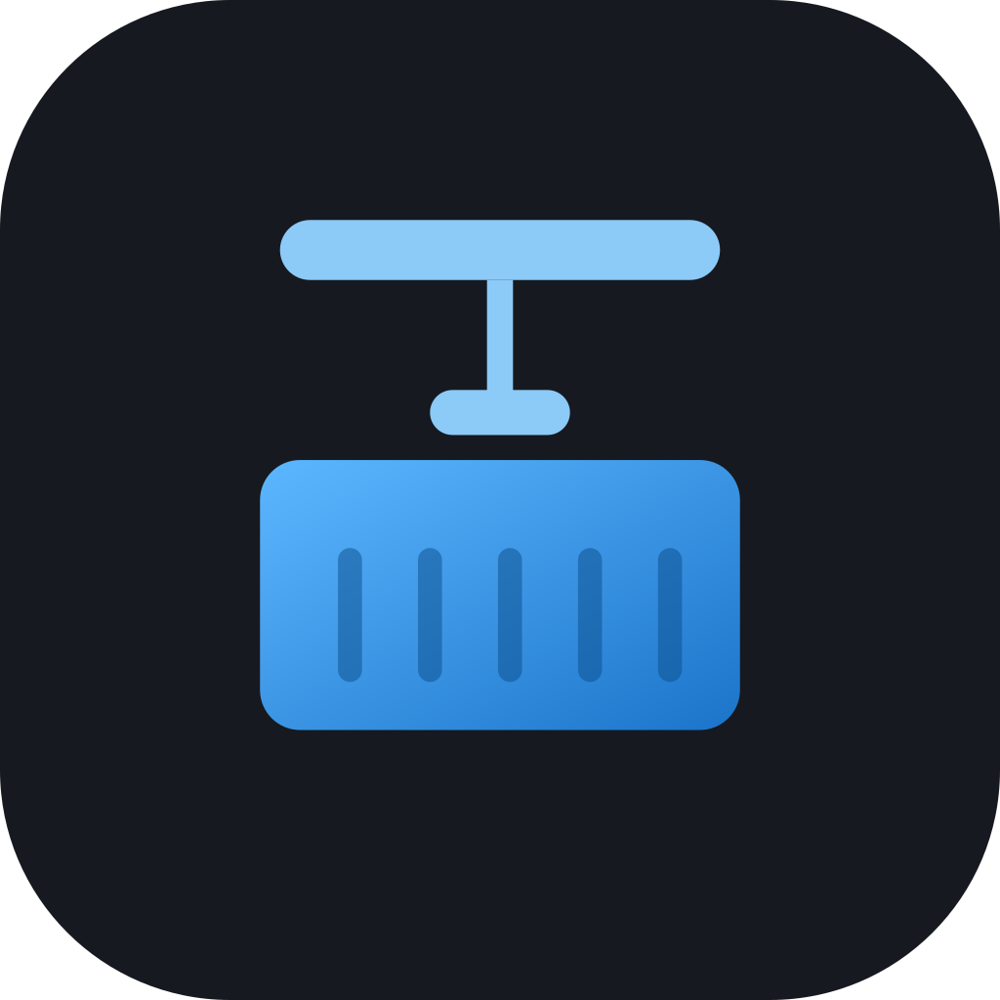
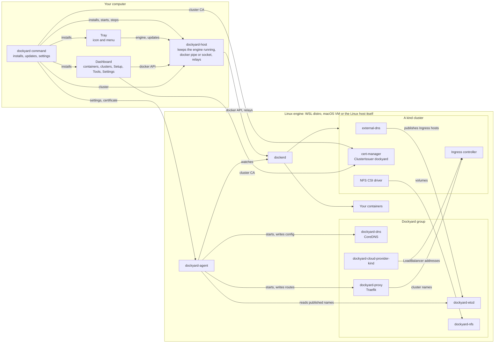
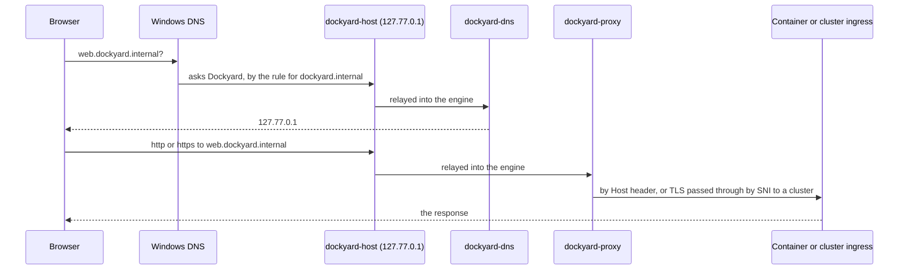
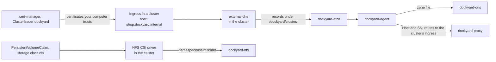

# Dockyard

Docker without Docker Desktop, on Windows, macOS and Linux. The engines start only when you need them, and there is one place to see and apply updates.

## Install

Run one line. It downloads the `dockyard` command and runs `dockyard setup`, which asks in the terminal which optional components you want and sets up everything, including what Docker needs from your system. When you choose the dashboard, setup opens it at **Tools** once it is done, with every component and its version. A silent install is there for scripts ([Without a window](#without-a-window)), but it is never the default.

**Windows 11**, in PowerShell:

```pwsh
irm https://raw.githubusercontent.com/byhofman/dockyard/main/install.ps1 | iex
```

**macOS** (Apple silicon, macOS 14 or newer):

```sh
curl -fsSL https://raw.githubusercontent.com/byhofman/dockyard/main/install-mac.sh | sh
```

**Linux** (x86_64):

```sh
curl -fsSL https://raw.githubusercontent.com/byhofman/dockyard/main/install.sh | sh
```

The line only reads `components.json` to find the command's latest release, downloads the command, checks it against that release's `SHA256SUMS` and runs `dockyard setup`. Your system may ask for an administrator's approval during setup, and if Windows has to restart, Dockyard carries on by itself afterwards.

Run the same line again at any time: setup brings what is installed up to date and keeps what you chose. Your images, containers and settings stay.

### Choose what you want

`dockyard setup` asks which optional components to install. Afterwards the dashboard's **Tools** section, and `dockyard component ls` in a terminal, list every component in groups (Dockyard, Docker, Kubernetes) with its version, where it came from (winget, Homebrew, apt, dnf or Dockyard's own download), the newest version and **Update to** it, plus **Add** or **Remove** where that is possible. Each row says what it needs or why it cannot go. The dashboard's **Settings** section and `dockyard settings` show the same settings.

Dockyard's own parts are released on their own, each with its own version: the `dockyard` command, the tray, the dashboard and the engine image. A fix to one of them does not wait for a release of everything.

The tray, or the dashboard when there is no tray, looks for updates by itself every six hours. A blue dot on the tray's icon and its tooltip say one is there; `dockyard update` or **Update to** in the dashboard's Tools brings it.

The command-line tools (the Docker CLI, Compose, Buildx, kind, kubectl and Helm) come from the system's package manager wherever it has them: winget on Windows, Homebrew on macOS, and on Linux the Docker, Kubernetes and Helm apt or dnf repositories. They then update the way everything else on the computer does (`winget upgrade`, `brew upgrade`, `apt upgrade`), and Dockyard's **Update** offers what the package manager has. Where there is no package manager, where it fails, or when you choose **Dockyard** under **Install docker, kind, kubectl and helm with** in setup or the dashboard's Settings (`--source dockyard`), the source is Dockyard: its own pinned downloads. On Windows, winget installs them for all users (`C:\Program Files\WinGet`), and Defender's prevalence rule gets an exclusion for exactly those files, so a brand-new release of a tool is not blocked.

With kubectl comes an optional shell setup (**Set up kubectl in my shell**, `--kubectl-shell`): `k` for kubectl with its completion, `$do` for `--dry-run=client -o yaml` and `$now` for `--force --grace-period 0`, as the Kubernetes exams have it; in PowerShell you splat them, `kubectl run web --image nginx @do`. It is a marked block in your PowerShell profiles and Git Bash's `.bashrc` on Windows, `.zshrc` on macOS and `.bashrc` on Linux, which Dockyard takes out again when you turn it off. In PowerShell `$do` and `$now` are lists, so `k run web --image nginx $do` passes them as separate arguments.

Everything Dockyard downloads itself (its own downloads of those tools, the engines and the credential helpers) has its version fixed per Dockyard release and is checked against a SHA-256 kept in Dockyard (`image/versions.env`, `image/versions.sha256`), so a replaced file upstream is refused. A new Dockyard release is what moves them.

| Component | | |
|---|---|---|
| `dockyard` command | Required | It installs and updates everything else; see [The dockyard command](#the-dockyard-command) |
| Tray | Optional | An icon and its menu, no window; the command and the tray are a whole install |
| Dashboard | Optional | The only Dockyard window: containers, clusters, and Setup, Tools and Settings |
| Docker Compose, Docker Buildx | Optional | Need the Docker CLI |
| kind | Optional | Kubernetes clusters in containers, on the Linux engine |
| kubectl, Helm | Optional | The Kubernetes command line, and the charts Clusters can add to a new cluster |
| Windows engine, Linux engine (Windows) | Optional, one has to stay | Removing keeps its images; adding it again brings them back |
| Docker CLI | Required | Everything else goes through it |
| Docker Engine (macOS VM, Linux) | Required | The only engine there. On Linux, Docker stays yours to remove with your package manager |

What you removed stays removed when you run setup again or update.

### Without a window

Add `dockyard setup`'s arguments to the same line:

```pwsh
& ([scriptblock]::Create((irm https://raw.githubusercontent.com/byhofman/dockyard/main/install.ps1))) --silent --without dashboard
```

```sh
curl -fsSL https://raw.githubusercontent.com/byhofman/dockyard/main/install.sh | sh -s -- --silent --without dashboard
```

The line runs `dockyard setup` with them; once installed, `dockyard` itself takes every other command. These are setup's arguments:

| Argument | Meaning |
|---|---|
| `--silent` | Do not ask: install, or bring what is installed up to date. Progress goes to the console. Needs no display or terminal. |
| `--with <names>` | Add components, comma separated or repeated, also on an existing install: `tray`, `dashboard`, `compose`, `buildx`, `kind`, `kubectl`, `helm`, and on Windows `linux-engine`, `windows-engine`. |
| `--without <names>` | Leave them out, or remove them, also when the package manager brought them. Asking for a required one or for the last engine exits 2 and changes nothing. With `--remove-data`, an engine's images go too. A later run leaves a tool that stayed out alone, also one you installed yourself. |
| `--source dockyard`, `--source package-manager` | Where the tools come from: Dockyard's own pinned downloads, or winget, Homebrew or apt/dnf (the default). Remembered for later runs. |
| `--kubectl-shell` | Add the kubectl shell setup (`k`, completion, `$do`, `$now`; `@do` and `@now` in PowerShell). `dockyard settings set kubectl-shell off` takes it out. |
| `--no-start` | Do not start Dockyard afterwards. |
| `--assets <folder>` | Take Dockyard's own release files (image, tray, dashboard, packages, the macOS app) from this folder instead of downloading them, for an install without internet or a build before its release. They are not checked, so only name a folder you filled yourself. |
| `--trust-https` | Add Dockyard's own certificate to the trust store, for HTTPS on container domains. |
| `--open-dashboard` | Open the dashboard's Setup screen when done. |

`dockyard import` copies images, volumes and containers from Docker Desktop, which keeps them (**Import** in the dashboard's Tools does the same). `dockyard uninstall` removes Dockyard and keeps images and containers; `dockyard uninstall --remove-data` takes them too.

### Engine only

The engine, the docker CLI and the Dockyard CLI, with no tray and no dashboard. On Windows Server the Linux engine is not part of a new install, so there is no WSL either; `--with linux-engine` adds it.

```pwsh
& ([scriptblock]::Create((irm https://raw.githubusercontent.com/byhofman/dockyard/main/install.ps1))) --silent --without tray --without dashboard
```

```sh
curl -fsSL https://raw.githubusercontent.com/byhofman/dockyard/main/install-mac.sh | sh -s -- --silent --without tray --without dashboard
curl -fsSL https://raw.githubusercontent.com/byhofman/dockyard/main/install.sh | sh -s -- --silent --without tray --without dashboard
```

The first sh line is for macOS, the second for Linux.

Without these, a new install gets everything and an existing install keeps what it has.

The exit code is `0` when done, `1` on failure with the reason on stderr, `2` for wrong arguments, and `3010` when Windows has to restart to finish. A silent install still needs administrator rights at some point: on Windows run it elevated to skip the prompt, on Linux run it as root or with passwordless sudo. On macOS it shows no prompt at all: without passwordless sudo it leaves out the `docker` entry on the PATH, `/usr/local/bin/dockyard` and Rosetta, says so, and running `dockyard setup` later with an administrator's approval adds them.

### Without the one-liner

Each release of the command (tagged `cli/<version>`, and marked as the latest release) has `dockyard-windows-x64.exe` for Windows, `dockyard-macos-arm64` for macOS and `dockyard-linux-x64` for Linux: download it and run `dockyard setup`. The same release carries what setup puts in place on macOS and Linux: `Dockyard-<version>-macos.zip` (the app with the tray, the dashboard and the command; `-macos-engine-only.zip` without the dashboard), `Dockyard-<version>-macos.dmg`, the `dockyard` deb and rpm (the command and the tray) and `Dockyard-<version>-linux-x64.tar.gz`. On Windows the tray comes from its own release (`tray/<version>`, `Dockyard.Tray.zip`, the tray with its native libraries) and the dashboard from its own (`dashboard/<version>`). Set `DOCKYARD_VERSION` to have the one-liner take a particular version of the command. On macOS, a browser download needs **System Settings → Privacy & Security → Open Anyway** once, because nothing has a Developer ID yet; the one-liner does not.

## What it sets up

**Windows.** WSL if it is missing, the Windows `Containers` feature, Docker's static engine in `C:\Program Files\Docker`, the docker CLI with compose and buildx, kind, kubectl and helm from winget (for all users; `~/.docker/config.json` gets winget's folder in `cliPluginsExtraDirs` so `docker compose` finds it), Dockyard itself in `C:\Program Files\Dockyard` (`bin\dockyard.exe` on the PATH, `dockyard-tray.exe`, `dockyard-dashboard.exe` and `dockyard-host.exe`), the `docker` service started on demand, a small `dockyard` WSL distro for Linux containers, the `linux` and `win` docker contexts, Defender exclusions for Dockyard, mirrored WSL networking unless you chose otherwise in `.wslconfig`, and autostart at logon.

| Context | Engine | Endpoint |
|---|---|---|
| `linux` (default) | Docker in the `dockyard` WSL distro (Alpine with Docker's static binaries) | `npipe:////./pipe/dockyard_linux` |
| `win` | `dockerd.exe` Windows service (ltsc2025 images, process isolation) | `npipe:////./pipe/docker_windows` |

The Linux engine has no open port on Windows: `dockyard-host`, a small background process of yours that starts at logon, keeps it running and serves it on a named pipe only you can open, and passes it to the distro with a secret only you can read. Tools that need `DOCKER_HOST` use that pipe. There is no TCP port, because every user of the PC and any web page could reach it.

Bind mounts of Windows folders work as you would write them: `docker run -v C:\src:/src` and Compose's `./src:/src` reach the Linux engine as `/c/src`, which the engine links to the drive.

**macOS.** Docker's `docker` CLI with compose and buildx, kind, kubectl and helm, from Homebrew when it is there, Rosetta for `linux/amd64` images, a small Linux VM on Apple's Virtualization.framework in `~/.dockyard`, the `dockyard` docker context, `docker`, `kind`, `kubectl` and `helm` on the PATH through `/usr/local/dockyard/bin` (small scripts that run your copy for your account only, or Homebrew's), `~/Applications/Dockyard.app` (the tray as its executable, the dashboard and the `dockyard` command, linked from `/usr/local/bin/dockyard`) and a login item for the tray, and `dockyard-host`, which runs the VM under a LaunchAgent of its own (`com.byhofman.dockyard.host`), so the engine keeps running when the tray and the dashboard are closed. It makes `/var/run/docker.sock` point at the engine unless another Docker app has it, and `docker login` keeps credentials in the Keychain. In the VM: `/Users`, `/Volumes` and the temp folders are shared at the same paths, so `-v $PWD:/app` works; published ports reach `127.0.0.1`, and so do servers in `--network host` containers; memory the guest does not use goes back to macOS.

**Linux.** Docker CE with buildx and compose from Docker's repository on Debian, Ubuntu, Fedora, RHEL and their derivatives, or from the distribution on Arch and openSUSE; kubectl from the Kubernetes project's apt or dnf repository and helm from Helm's apt repository or Fedora's own, with kind (and the others where there is neither apt nor dnf) as Dockyard's own copy in `/usr/local/bin`; the Dockyard packages (`dockyard` with the command and the tray, and `dockyard-dashboard`, in `/usr/lib/dockyard`, with `/usr/bin/dockyard` the command), or a copy in `~/.local/lib/dockyard` on distributions without apt or dnf; the engine started on demand; `dockyard-host.service`, which comes and goes with the engine; docker access for you right away; the tray with its GNOME extension where needed, started at login.

## How it fits together



- **The `dockyard` command** is the one required component. It installs, updates and removes every component, holds the settings, and does what needs an administrator: the DNS rule that sends `dockyard.internal` to Dockyard, and trusting Dockyard's certificate authority. On Windows the installed command is also the elevated worker the others hand those steps to. The tray and the dashboard do the same things through the same library, `Dockyard.Setup`, so a rule exists once.
- **The tray** is an icon and its menu, with no window: the engine's state and Start/Stop, switching engines, the containers, and links into the dashboard. While it runs it checks for updates and keeps the certificate current; without it, the dashboard does. It listens on no port and holds no engine: quitting it changes nothing that runs.
- **The dashboard** is the only Dockyard window: containers, images, volumes, networks, builds and clusters, and **Setup**, **Tools** and **Settings**.
- **dockyard-host** is the small OS-native part that has to run while the engine does. On Windows it keeps the WSL distro running, serves the engine's named pipe and relays `127.77.0.1` and published ports into it; on macOS it runs the VM, under a LaunchAgent of its own; on Linux, where the engine is the machine's own Docker, it is a systemd unit next to it.
- **The dashboard and the `dockyard` command** talk to the engine over the docker API, as any docker client does.
- **The agent**, inside the engine, watches the containers and kind clusters and runs Dockyard's service containers. It writes what they serve; they do the serving.
- **Everything else is containers too:** kind's cloud provider gives LoadBalancer services an address, `dockyard-nfs` serves NFS storage to the clusters that use it, and in each cluster external-dns, cert-manager and the NFS CSI driver are ordinary pods that talk to Dockyard's containers. The dashboard shows Dockyard's own in the **Dockyard** group.
- **The Windows engine** (`dockerd.exe`, Windows containers) is a Windows service of its own. It has no container domains and no kind: both are Linux only.
## Using it

Dockyard sits in the tray or menu bar. The icon is the Dockyard crane and container: blue when the engine runs, gray when stopped, amber while busy; on Windows a badge shows the active context (`L` or `W`). Click to open the dashboard; right-click for the rest: the engine's state with **Start** or **Stop**, **Linux** and **Windows** to switch the docker context on Windows (which starts that engine and by default stops the other one), **Containers** with start, stop, restart and open for each container, **Open dashboard**, **Tools…** and **Settings…**.

In the dashboard:

- **Tools**: every component with its version, where it came from, the newest version and **Update to** it, plus **Add** or **Remove** where that is possible, and **Import** from Docker Desktop. Checked when it opens, at most every 6 hours, or on **Check for updates**. Updating an engine keeps its images and containers. **Uninstall** is on Dockyard's own row.
- **Settings**: Domains & HTTPS, the engine (stop the other engine when switching, start the active engine at logon, and its `daemon.json`, which `dockyard config edit` opens in your editor, checked before it is applied, with the previous one put back if the engine does not start; the keys Dockyard sets itself are kept), where the tools come from, and the kubectl shell setup.
- **Setup**: what `dockyard setup` is doing, step by step, with its log.

### Dashboard

Its process is called `dockyard-dashboard` in Task Manager, Activity Monitor and `ps` (`Dockyard Dashboard` inside the macOS app).

It follows the active docker context and updates live from the engine's events. Closing its window leaves it running in the background (about 50 MB of memory, next to no CPU), so it opens again at once; **Quit** in the tray menu ends it too.

- **Containers**: running and stopped, with ports (click to open `http://127.0.0.1:<port>`) and live CPU and memory. Compose projects and kind clusters are expandable rows, with their containers under them. Per container: logs, **Files** (read, edit, download and upload, also in stopped containers and images without a shell), inspect, graphs, and **Terminal**. A compose project has up, stop, restart, pull and down, and three tabs: its services, its **Compose file** (edit it with a live check by `docker compose config`, then **Save** or **Save and apply**, which runs `up -d`) and its merged **Logs**. **Open compose file…** starts a project from a file. Dockyard's own containers (`dockyard-dns`, `dockyard-proxy`, `dockyard-etcd`, kind's cloud provider, the NFS server) are in a read-only **Dockyard** group at the end; the **Dockyard** button hides it.
- **Images**: pull with progress, tags, size, which containers use them, **All / In use / Unused**, remove, prune.
- **Volumes**: size, which containers use them, **All / In use / Unused**, remove, prune. **Files** shows what is in a volume, to read, edit, download or upload; on Windows **Open in Explorer** opens its folder.
- **Builds**: every `docker build` on the engine from BuildKit's history, with a check or a cross, when it started, how long it took and its steps (`7/8 (2 cached)`). A build shows its error, where it came from, and each step with its time, its share of the build as a bar, and its logs to expand.
- **Networks**: subnet, connected containers, connect, disconnect, create, remove, prune.
- **Disk**: `docker system df` per category; prune per category or **Clean everything unused**.

**Search** (`Ctrl+K`, `⌘K` on macOS) finds containers, compose projects, images, volumes, networks and clusters at once, grouped by kind; `Up`/`Down` and `Enter` open a result in its section. It also filters the section on screen.

Keys: `S` start/stop, `R` restart, `E` terminal, `L` logs, `Del` remove (with confirmation), `Left`/`Right` collapse or expand a compose project.

The footer shows the step at hand and the version; the log icon at its left opens the activity log across the window, with each action, the commands it ran and their output. When the docker command, Compose or Buildx is missing, a line at the top says so and what is off until you add it in Tools.

## Kubernetes with kind

Dockyard installs [kind](https://kind.sigs.k8s.io), which runs a Kubernetes cluster as containers on the Linux engine, with kubectl and [Helm](https://helm.sh): from winget on Windows and Homebrew on macOS, like the other tools. Without them, and for kind on Linux, which has no repository, they come from Dockyard, as its own downloads in `C:\Program Files\Docker`, `~/.dockyard/bin` or `/usr/local/bin`, with a version fixed per Dockyard release and checked against a checksum kept in Dockyard. A kind, kubectl or helm that someone else put in `/usr/local/bin` on Linux is left alone and used.

From a terminal it is kind itself:

```sh
kind create cluster --name dev     # also adds kind-dev to ~/.kube/config and makes it the current context
kind get clusters
kind get kubeconfig --name dev
kind delete cluster --name dev
```

On Windows, kind uses the `linux` context, the default; with `win` active it has no Linux engine to run on.

In the dashboard, **Kubernetes** lists them from the engine with their Kubernetes version, nodes and API server, creates and deletes them, copies a cluster's kubeconfig and makes its context the current one. Creating a cluster there adds its context to `~/.kube/config` (or the first existing file in `$KUBECONFIG`) and makes it current; deleting it takes exactly those entries out again and goes back to the context that was current before. The first time Dockyard changes that file it keeps a copy next to it, `config.dockyard-backup`. Any kubectl reaches the cluster with `--context kind-<name>`.

- **Add-ons:** with Helm installed, creating a cluster can put these charts in it, at versions fixed per Dockyard release: [metrics-server](https://github.com/kubernetes-sigs/metrics-server) (on by default), so `kubectl top` and pod autoscaling work, and [Traefik](https://traefik.io) as an ingress controller, whose `LoadBalancer` service shows up under the cluster's load balancers with its `http://127.0.0.1:<port>` links. kind's kubelets serve certificates without their IP address, so metrics-server runs with `--kubelet-insecure-tls`. The third is [cert-manager](https://cert-manager.io), with a `ClusterIssuer` called `dockyard` when trusted HTTPS is on: a certificate authority under Dockyard's own, valid only for `*.<cluster>.dockyard.internal`, so an Ingress with `cert-manager.io/cluster-issuer: dockyard` gets a certificate your browser already trusts. Its key is in the cluster; Dockyard's root key never leaves this computer. All three are ordinary Helm releases: `helm upgrade` and `helm uninstall` work on them.

- **Creating a cluster** asks first for what to put in it (workers, storage, the load balancer and its ports, the add-ons), and shows kind's cluster config that follows from that last, to change by hand if you want. Dockyard keeps each cluster's definition, so **Duplicate** makes another like it and **Recreate** makes it again from a changed definition (kind cannot change a cluster that exists, so everything in it goes).
- **Kubernetes version:** chosen when you create a cluster, from the node images the pinned kind brings (the newest by default, `--kubernetes` on the command line). kind cannot upgrade a cluster in place, so **Upgrade…** (`dockyard cluster upgrade <name>`) makes it again on a newer version from its definition, with its add-ons: its workloads and node-local volumes go, files on shared and NFS storage stay.
- **Load balancers:** a `type: LoadBalancer` service gets an IP through kind's [cloud provider](https://github.com/kubernetes-sigs/cloud-provider-kind), which Dockyard runs as one container for every cluster whose load balancer is on (per cluster, on by default). Clusters shows each service's load balancer IP and its ports as `http://127.0.0.1:<port>` links that work from this computer. **Fixed ports** are optional per cluster: a port such as 8080 goes to the service that has it on `127.0.0.1:8080`; a port another cluster or program holds is reported, and the service keeps the port Docker picked. Besides it, Dockyard puts only [external-dns](https://github.com/kubernetes-sigs/external-dns) in a cluster with a load balancer (see below): no Gateway API, and an ingress controller only when you tick Traefik.
- **Ingress by name:** with an ingress controller such as Traefik, any `<host>.<cluster>.dockyard.internal` reaches it on ports 80 and 443, so an Ingress for `shop.dev.dockyard.internal` works in the browser as is, HTTPS with the cluster's own certificate, passed through untouched. Other names under `dockyard.internal` work too: external-dns in the cluster publishes the hosts of its Ingresses (and `LoadBalancer` services with an `external-dns.alpha.kubernetes.io/hostname` annotation), so an Ingress for `shop.dockyard.internal` resolves on this computer and in every container. A name a container already has stays the container's, and a cluster's names go with it when it stops or is deleted.
- **Storage that every node uses at once**, chosen per cluster when you create it: a **shared host folder** (a `shared` StorageClass over one folder on the engine, with a button that opens it), or **NFS** (an `nfs` StorageClass through the NFS CSI driver, served by a `dockyard-nfs` container that every cluster with NFS shares). Both are ReadWriteMany with reclaim policy Retain, and put each claim in `<namespace>/<claim>`, so pods on different nodes and in different clusters see the same files, and they survive deleting the claim.

## The dockyard command

`dockyard` (`dockyard-cli` inside the macOS app) does from a terminal what the tray and the dashboard do, and is what installs them. `dockyard --help` lists everything, and each command has `--help` too.

```sh
dockyard engine ls                      # the engines and whether they run
dockyard engine start linux             # also stop, and use (makes it the docker context)
dockyard config edit --engine linux     # daemon.json in your editor, checked, then applied
dockyard cluster create dev --workers 2 --addons metrics-server,traefik,cert-manager --storage nfs
dockyard cluster ls                     # also recreate, upgrade, delete, use, kubeconfig, definition
dockyard https on
dockyard update --check
```

Every command runs in the command itself, over the same library the tray and the dashboard use. `dockyard setup` installs and asks which optional components you want (`dockyard setup --silent --with kind --without tray` does not ask), `dockyard component ls|add|remove <flag>` changes them, and `dockyard settings ls|get|set`, `dockyard uninstall` and `dockyard import` do what their names say. The exit code is `0` when done, `1` on failure and `2` for wrong arguments.

## Container domains

Every running container answers at `http://<container name>.dockyard.internal`, and a Compose service also at `http://<project>-<service>.dockyard.internal`, without publishing a port and without clashing with anything else on your machine. Dockyard picks the port by looking at what the container listens on, the usual web ports first. If that is the wrong one, set it next to the name in the dashboard, or with a `dockyard.port` label.

Names are served by containers in the Dockyard group, pinned by digest: `dockyard-dns` ([CoreDNS](https://coredns.io)), `dockyard-proxy` ([Traefik](https://traefik.io)), and `dockyard-etcd`, where clusters publish their names. The engine's agent writes what they serve from the running containers. If their images cannot be pulled, offline or behind a registry that blocks them, the agent answers for the names itself.

**HTTPS:** turn it on under **Settings** in the dashboard (`dockyard https on`), or add `--trust-https` to a silent setup. Dockyard makes a certificate authority of its own on this device, valid only for names under `dockyard.internal`, and your system asks for approval to trust it. Say no and everything keeps working over plain HTTP. Its key stays on this device, readable only by you; turning HTTPS off or uninstalling removes it from the trust store.

### How names and requests get there

Container domains are container native: the names, the proxy and what clusters publish are ordinary containers on the engine, configured by the agent. On Windows a request for a name goes like this; macOS has its own resolver file and relays in dockyard-host, and on Linux the machine reaches the engine directly.



Inside the engine, containers use `dockyard-dns` as their DNS server: Dockyard's names resolve to `198.19.250.1`, where ports 80 and 443 lead to `dockyard-proxy`, and every other name goes to your network's DNS as before.

A kind cluster uses Dockyard's containers the same way, for names it publishes, certificates and shared storage:



**Container domains** in the dashboard's Settings switches all of this off: `dockyard-proxy` and `dockyard-etcd` go, and `dockyard-dns` stays as the containers' DNS server without Dockyard's names.
## Your network

Containers reach your machine as `host.docker.internal`, including services that only listen on its loopback. The engine and its containers use the proxy your system is set to, also one on your machine's own loopback, read each time the engine starts. Name lookups go through your system's DNS at that moment, and traffic leaves through your machine's routes, so VPNs apply to containers as they do to your other apps.

## Known limits

- On Windows some features are the Linux engine's alone, and their settings say "(Linux engine only)": container domains and trusted HTTPS for them, kind clusters with everything under them (add-ons, load balancers, shared and NFS storage), and the build history, which comes from BuildKit. With the `win` context active they are off for Windows containers; switch to `linux` to use them.
- Firefox keeps its own trust store on macOS and Windows, so it warns about HTTPS on container domains unless its enterprise roots setting is on.
- Container domains need systemd-resolved on Linux; other setups have no place to route one name space, and setup says so. Reaching them on macOS may ask once for Local Network access for your browser, since the name points at the VM.
- A proxy auto-config (PAC) file is not followed: it can choose a different proxy per address, and the engine takes one fixed proxy. Set a fixed proxy in your system's settings if pulls fail behind one.
- On macOS, `/var/run/docker.sock` stays with another Docker app when one already has it, such as OrbStack or Docker Desktop. Tools that ignore docker contexts keep using that app until it gives up the path.
- On Linux without a desktop session there is no OS credential store, so `docker login` keeps Docker's default there.
- On a device whose Defender settings are managed by an organisation (Intune), local exclusions may not count. If Defender blocks Dockyard (event 1121) or `dockerd.exe` (event 1127), your administrator has to allow `C:\Program Files\Dockyard\` and `C:\Program Files\Docker\dockerd.exe`.

## Build

The .NET SDK has to be 10.0.403 or newer: restore fails on older ones because the NativeAOT compiler they select has a known vulnerability (NU1903).

```pwsh
dotnet test --solution Dockyard.slnx
dotnet publish src/Dockyard.Cli/Dockyard.Cli.csproj -c Release -r win-x64 -o out/cli
dotnet publish src/Dockyard.Tray/Dockyard.Tray.csproj -c Release -r win-x64 -o out/tray
dotnet publish src/Dockyard.Dashboard/Dockyard.Dashboard.csproj -c Release -r win-x64 -o out/dashboard
```

The tray and the dashboard are native AOT builds and need the platform's C++ tools. The CLI's release build embeds what it installs on Windows: `-p:GuestBundle=<guest tarball>` and `-p:HostExe=<dockyard-host.exe>` reach `Dockyard.Setup` through its publish. Each component is released from a tag of its own, `cli/<version>`, `tray/<version>`, `dashboard/<version>` or `engine/<version>`, or all four at once from `v<version>`: the build workflow builds and tests only what that component needs (the CLI also runs `dockyard setup --silent` for real on Windows, macOS and Linux), publishes the release from a draft once all its assets are there, and records it in `components.json` on the release tagged `index`, where `dockyard` and the one-liners find each component's latest. The CLI's release is the one marked latest. See [docs/design/components-and-releases.md](docs/design/components-and-releases.md).

`tests/e2e` runs `dockyard setup` or a published one-liner end to end, `tests/oneliners` checks that the scripts only fetch and check the `dockyard` command and run `dockyard setup`, `scripts/mac-e2e.sh` checks the VM on a Mac, and `scripts/measure.ps1` checks the dashboard's budgets. Integration tests (`Category=Engine`) run against real engines and are skipped when none is running.

## License

MIT. The dashboard icons are [Fluent UI System Icons](https://github.com/microsoft/fluentui-system-icons) (MIT, Microsoft); the Kubernetes logo is from [Simple Icons](https://simpleicons.org) (CC0), and Kubernetes is a trademark of The Linux Foundation.
